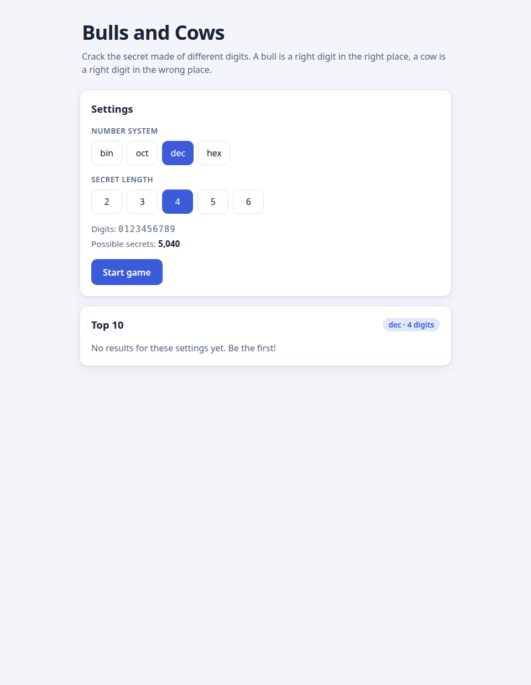

# Bulls and Cows

A number-guessing game: the computer picks a secret of _N_ different digits and you work
it out. A **bull** is a right digit in the right place, a **cow** is a right digit in the
wrong place.

Written in strict TypeScript as a pure functional core plus a thin DOM shell — no
framework, no bundler: `tsc` emits ES modules that the browser loads directly.



## Features

- Secrets of 2–6 unique digits in **binary, octal, decimal or hexadecimal**
  (binary secrets are always 2 digits)
- Live input filtering per number system; upper-case hex digits are accepted
- Attempt history with bulls/cows for every guess, a round timer, duplicate detection
- Settings are locked while a round is running; **New game** returns to the settings
  screen without a reload
- Top-10 leaderboard **per settings combination**, persisted in `localStorage` and
  surviving page reloads
- Keyboard-first UI (the guess field stays focused), works offline once loaded

## Getting started

```bash
npm ci          # install dependencies
npm run build   # compile src/ -> dist/
```

Then serve the project root with any static file server and open it:

```bash
npx serve .                    # or: python3 -m http.server
# -> http://localhost:3000 (or :8000)
```

`index.html` loads `./dist/main.js` as an ES module, so opening the file directly via
`file://` will not work — use a server.

## Scripts

| Command                           | What it does                                     |
| --------------------------------- | ------------------------------------------------ |
| `npm run build`                   | compile `src/` to `dist/`                        |
| `npm test`                        | run all Vitest suites (order is shuffled)        |
| `npm run lint`                    | strict ESLint, zero warnings allowed             |
| `npm run typecheck`               | `tsc --noEmit` for the app and the DOM-free core |
| `npm run format` / `format:check` | Prettier write / check                           |

Git hooks: `pre-commit` runs lint-staged, `pre-push` runs the full test suite.

## Project layout

```text
index.html          document shell; the body is built by code
styles.css          all styles (light/dark, mobile)
src/main.ts         entry point: injects Math.random / Date.now / localStorage
src/ui/             DOM renderers + the stateful app shell (no innerHTML anywhere)
src/core/           pure game domain: no DOM, no classes, immutable state
src/storage/        KeyValueStore abstraction + localStorage adapter
tests/              Vitest suites: table-driven core tests + jsdom UI smoke tests
```

## Design and testing notes

See [DESIGN.md](DESIGN.md) for the data structures, the algorithms (with complexity)
behind `generateSecret`, `evaluateGuess`, `isValidGuess`, `createDigitValidator` and
`countPossibleSecrets`, and how the Clean Code principles from the course module are
applied.

## Deployment (GitHub Pages)

The app is fully static — it needs nothing but a file server. The workflow in
`.github/workflows/deploy.yml` runs the test suite, builds `dist/`, assembles `_site/`
(`index.html` + `styles.css` + `dist/`) and publishes it via the official Pages actions.

One-time setup in the repository: **Settings → Pages → Source → GitHub Actions**.
After that, every push to `bulls-and-cows` redeploys the site.

All asset paths are relative (`./styles.css`, `./dist/main.js`), so the site works under
any base path, including `https://<user>.github.io/<repo>/`.
